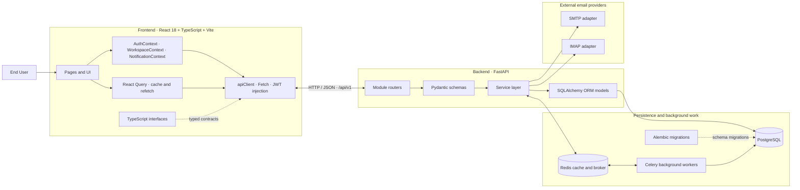
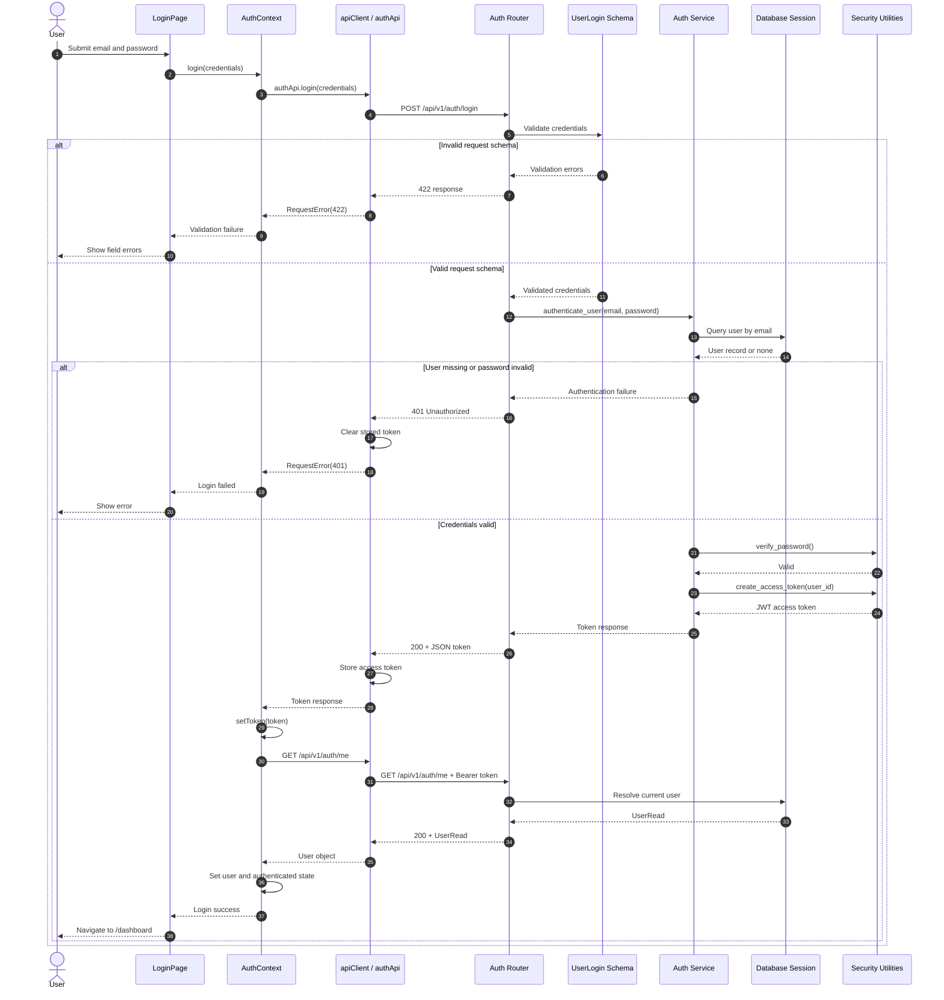
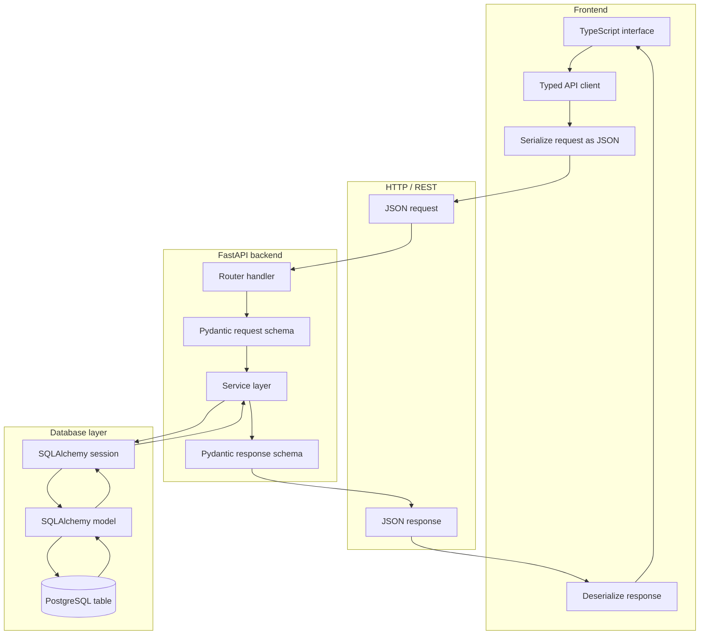
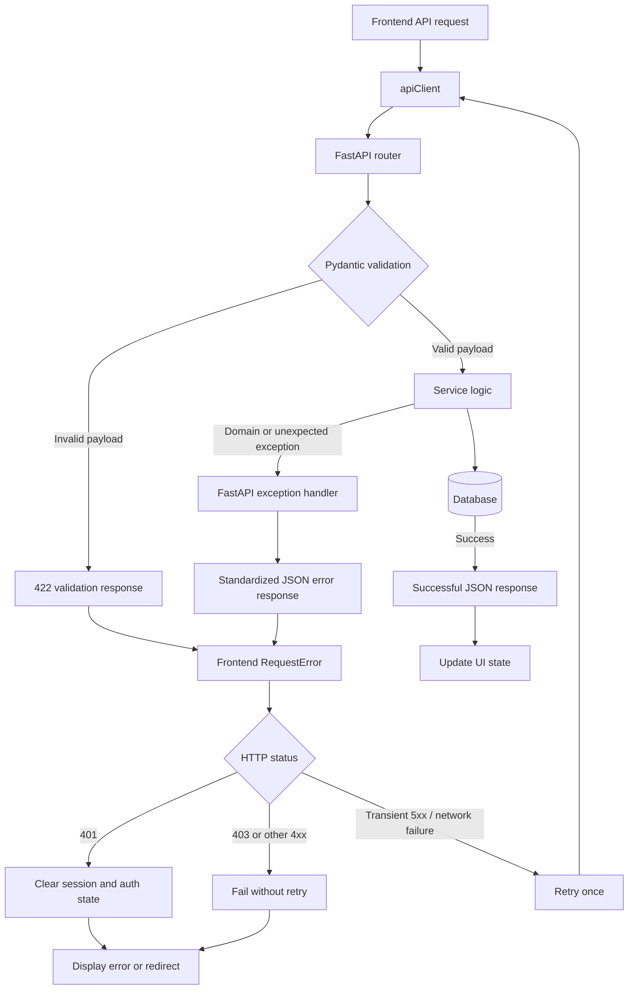

# Email Monitoring System — Mermaid Architecture Document

**Source:** `PROJECT_ARCHITECTURE_FLOWS.md`  
**Scope:** The architecture, authentication sequence, TypeScript-to-database lifecycle, and global error handling described in the source document.

> Validation note: Mermaid fences, diagram-family declarations, and structural references were checked statically. This is not proof of acceptance by every Mermaid renderer; no local Mermaid CLI renderer was available during preparation.

## Diagram index

1. **System architecture overview** — major frontend, backend, storage, and integration responsibilities.
2. **Authentication sequence** — login validation, credential verification, JWT issuance, `/auth/me`, and failure branches.
3. **Data model lifecycle** — typed frontend contracts through FastAPI/Pydantic/services/SQLAlchemy/PostgreSQL and back.
4. **Global error handling** — frontend HTTP handling and backend validation/service/database exception paths.

## 1. System architecture overview

## 2. Global user session authentication

## 3. TypeScript-to-database data lifecycle

## 4. Global API error handling

## Source alignment and limitations

- The frontend contexts, `apiClient`, React Query, FastAPI router/schema/service/model layers, SQLAlchemy, PostgreSQL, Alembic, Redis, Celery, and SMTP/IMAP adapters are taken from the supplied architecture description.
- The authentication sequence follows the supplied login and `/api/v1/auth/me` flow, including the 422 and 401 branches.
- The lifecycle diagram represents the documented TypeScript → JSON → Pydantic → service/ORM → PostgreSQL path and response path.
- The error diagram reflects the documented `RequestError`, 401 session cleanup, no retry for 401/403, one retry for transient failures, Pydantic 422 responses, and FastAPI exception handlers.
- The source describes JWT token lifecycle/session persistence, but does not specify a refresh-token endpoint or refresh-token exchange. No such flow is added here.
- These diagrams are explanatory views of the supplied document, not independent verification of implementation files.
