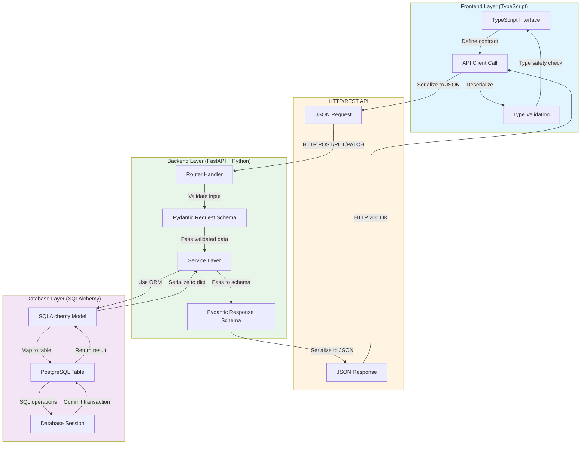

# Project Architecture Flows

## System Design Overview

The Email Monitoring System is a full-stack monorepo application built with a React TypeScript frontend and FastAPI Python backend. The architecture follows a clean separation of concerns with distinct layers for presentation, business logic, data access, and external integrations.

### Frontend Architecture (React + TypeScript)

The frontend is a Single Page Application (SPA) built with React 18, TypeScript, and Vite. It employs a context-based state management pattern with three primary context providers:

- **AuthContext**: Manages user authentication state, JWT token lifecycle, and session persistence
- **WorkspaceContext**: Handles multi-tenancy by managing active company/workspace selection and role-based permissions
- **NotificationContext**: Provides toast notification system for user feedback

The API layer is abstracted through a centralized `apiClient` in `services/api.ts` that provides typed endpoints for all backend services. HTTP requests use the native Fetch API with automatic JWT token injection, error handling, and retry logic. React Query (@tanstack/react-query) provides server state management with caching and automatic refetching.

### Backend Architecture (FastAPI + Python)

The backend follows a modular router-based architecture with clear separation between:

- **Routers**: FastAPI route handlers in `app/modules/*/routes.py` that define API endpoints
- **Schemas**: Pydantic models in `app/modules/*/schemas.py` for request/response validation
- **Services**: Business logic layer in `app/modules/*/service.py` implementing core operations
- **Models**: SQLAlchemy ORM models in `app/modules/*/models.py` defining database tables

Database access uses SQLAlchemy 2.0 with async sessions for FastAPI routes and sync sessions for background workers. PostgreSQL serves as the primary data store with Alembic for database migrations. Redis provides caching and acts as a message broker for Celery-based background task processing.

### Key Design Patterns

1. **Dependency Injection**: FastAPI's dependency system provides database sessions, authentication state, and other services to route handlers
2. **Repository Pattern**: Service layers abstract database operations from route handlers
3. **Adapter Pattern**: IMAP and SMTP services abstract external email provider integrations
4. **Context Providers**: React Context API provides global state without prop drilling
5. **Type Safety**: TypeScript interfaces mirror Pydantic schemas, ensuring end-to-end type safety

---

## Flow 1: Global User Session Authentication and API Data Token Validation

```mermaid
sequenceDiagram
    autonumber
    actor User as End User
    participant Login as LoginPage<br/>(frontend/src/pages/LoginPage.tsx)
    participant AuthCtx as AuthContext<br/>(frontend/src/context/AuthContext.tsx)
    participant API as authApi<br/>(frontend/src/services/api.ts)
    participant Router as Auth Router<br/>(backend/app/modules/auth/routes.py)
    participant Schema as Pydantic Schema<br/>(backend/app/modules/auth/schemas.py)
    participant Service as Auth Service<br/>(backend/app/modules/auth/service.py)
    participant DB as Database Session<br/>(backend/app/core/database.py)
    participant Model as User Model<br/>(backend/app/modules/auth/models.py)
    participant Security as Security Utils<br/>(backend/app/core/security.py)

    User->>Login: Enter credentials and submit
    activate Login
    Login->>AuthCtx: login(credentials)
    activate AuthCtx
    
    AuthCtx->>API: authApi.login(credentials)
    activate API
    
    API->>API: Build POST /api/v1/auth/login
    API->>API: Set Content-Type: application/json
    API->>Router: POST /api/v1/auth/login
    activate Router
    
    Router->>Schema: Validate UserLogin schema
    activate Schema
    
    alt Validation Successful
        Schema-->>Router: Validated credentials
        deactivate Schema
        
        Router->>Service: authenticate_user(email, password)
        activate Service
        
        Service->>DB: get_db() dependency
        activate DB
        
        DB->>Model: Query User.by_email(email)
        activate Model
        
        Model-->>DB: User record or None
        deactivate Model
        
        DB-->>Service: User object
        deactivate DB
        
        alt User exists and password valid
            Service->>Security: verify_password(plain, hashed)
            activate Security
            
            Security-->>Service: boolean result
            deactivate Security
            
            Service->>Security: create_access_token(user_id)
            activate Security
            
            Security-->>Service: JWT token string
            deactivate Security
            
            Service->>Service: build Token response
            Service-->>Router: Token(access_token, token_type, expires_in)
            deactivate Service
            
            Router-->>API: 200 OK + JSON response
            deactivate Router
            
            API->>API: Parse response
            API->>API: tokenStorage.set(access_token)
            API-->>AuthCtx: Token response
            deactivate API
            
            AuthCtx->>AuthCtx: setToken(access_token)
            AuthCtx->>AuthCtx: refreshUser()
            AuthCtx->>API: authApi.getMe()
            activate API
            
            API->>API: GET /api/v1/auth/me with Authorization header
            API->>Router: GET /api/v1/auth/me
            activate Router
            
            Router->>DB: get_db() dependency
            activate DB
            
            DB->>Model: Query User by ID from JWT
            activate Model
            
            Model-->>DB: UserRead schema
            deactivate Model
            
            DB-->>Router: UserRead object
            deactivate DB
            
            Router-->>API: 200 OK + UserRead
            deactivate Router
            
            API-->>AuthCtx: User object
            deactivate API
            
            AuthCtx->>AuthCtx: setUser(user)
            AuthCtx->>AuthCtx: setIsAuthenticated(true)
            AuthCtx->>AuthCtx: setIsLoading(false)
            AuthCtx-->>Login: Login success
            deactivate AuthCtx
            
            Login->>Login: Navigate to /dashboard
        else User not found or invalid password
            Service-->>Router: 401 Unauthorized
            deactivate Service
            
            Router-->>API: 401 error response
            deactivate Router
            
            API->>API: RequestError(401, message)
            API->>API: handle401Unauthorized()
            API->>API: tokenStorage.clear()
            API-->>AuthCtx: Error thrown
            deactivate API
            
            AuthCtx->>AuthCtx: setToken(null)
            AuthCtx->>AuthCtx: setUser(null)
            AuthCtx->>AuthCtx: setIsAuthenticated(false)
            AuthCtx-->>Login: Login failed
            deactivate AuthCtx
            
            Login->>Login: Display error message
        end
    else Validation Failed
        Schema-->>Router: 422 Validation Error
        deactivate Schema
        
        Router-->>API: 422 error response
        deactivate Router
        
        API->>API: RequestError(422, validation_errors)
        API-->>AuthCtx: Error thrown
        deactivate API
        
        AuthCtx-->>Login: Validation error
        deactivate AuthCtx
        
        Login->>Login: Display field errors
    end
    deactivate Login
```

### Authentication Flow Code Mapping

#### Frontend Flow

1. **Login Page** - `frontend/src/pages/LoginPage.tsx`
   - Form captures user email and password
   - Submits to AuthContext login method
   - Handles success/error states and navigation

2. **AuthContext** - `frontend/src/context/AuthContext.tsx` (lines 1-80)
   - `login(credentials: LoginCredentials)` method (lines 10-13)
   - Token storage management via `tokenStorage` (lines 20, 25-26)
   - `refreshUser()` fetches current user profile (lines 36-50)
   - `handle401Unauthorized()` clears session on 401 errors (lines 23-27)
   - State: user, token, isAuthenticated, isLoading

3. **API Client** - `frontend/src/services/api.ts` (lines 78-230)
   - `tokenStorage` object for localStorage operations (lines 78-100)
   - `RequestError` class for HTTP error handling (lines 102-112)
   - `handle401Unauthorized()` automatic session cleanup (lines 122-136)
   - `request<T>()` core HTTP method with token injection (lines 138-189)
   - `authApi.login()` endpoint (lines 214-220)
   - `authApi.getMe()` endpoint (lines 221-223)

4. **TypeScript Types** - `frontend/src/types/auth.ts` (lines 1-111)
   - `LoginCredentials` interface (lines 15-18)
   - `Token` interface (lines 9-13)
   - `User` interface (lines 1-7)
   - `AuthState` interface (lines 26-31)

#### Backend Flow

5. **Main Application** - `backend/app/main.py` (lines 1-76)
   - FastAPI app factory `create_application()` (lines 29-73)
   - Router registration: `auth_router` at `/api/v1` prefix (line 52)
   - CORS middleware configuration (lines 42-49)
   - Lifespan events for Redis connection management (lines 19-26)

6. **Auth Router** - `backend/app/modules/auth/routes.py`
   - POST `/login` endpoint with UserLogin schema validation
   - GET `/me` endpoint for current user profile
   - Dependency injection for database sessions

7. **Pydantic Schemas** - `backend/app/modules/auth/schemas.py` (lines 1-72)
   - `UserLogin` schema (lines 13-17) - validates email and password
   - `Token` schema (lines 19-23) - JWT response structure
   - `UserRead` schema (lines 64-72) - public user information
   - `UserProfileUpdate` schema (lines 34-48)
   - `UserPasswordChange` schema (lines 51-56)

8. **Auth Service** - `backend/app/modules/auth/service.py`
   - `authenticate_user(email, password)` method
   - Password verification using security utilities
   - JWT token generation and response construction

9. **Database Session** - `backend/app/core/database.py` (lines 1-53)
   - `Base` declarative class for SQLAlchemy models (lines 12-14)
   - `async_engine` for FastAPI async operations (lines 18-23)
   - `AsyncSessionLocal` session factory (lines 25-31)
   - `sync_engine` for Alembic and background workers (lines 34-38)
   - `SyncSessionLocal` session factory (lines 40-44)
   - `get_db()` dependency injection function (lines 47-53)

10. **User Model** - `backend/app/modules/auth/models.py` (lines 1-57)
    - `User` table definition (lines 13-57)
    - Fields: id, email, hashed_password, full_name, is_active, is_superuser
    - Relationships: company_memberships, email_account_access, sent_emails
    - Indexes on email for fast lookups

11. **Security Utilities** - `backend/app/core/security.py`
    - Password hashing and verification functions
    - JWT token creation with user claims
    - Token decoding and validation
    - SECRET_KEY and ALGORITHM configuration

---

## Flow 2: Data Model Lifecycle - TypeScript to Database



### Data Model Lifecycle Code Mapping

#### Frontend Type Definitions

1. **Email Types** - `frontend/src/types/emails.ts` (lines 1-288)
   - `EmailItem` interface (lines 12-39) - Maps to backend EmailRead schema
   - `EmailSendPayload` interface (lines 167-180) - Maps to EmailSendRequest schema
   - `EmailDraftPayload` interface (lines 182-194) - Maps to EmailDraftRequest schema
   - `EmailTemplateItem` interface (lines 196-208) - Maps to EmailTemplateRead schema
   - `EmailSignatureItem` interface (lines 235-246) - Maps to EmailSignatureRead schema
   - `EmailAccountItem` interface (lines 99-120) - Maps to EmailAccountRead schema

2. **Auth Types** - `frontend/src/types/auth.ts` (lines 1-111)
   - `User` interface (lines 1-7) - Maps to UserRead schema
   - `CompanyWithRole` interface (lines 35-41) - Maps to CompanyRead schema
   - `CompanyMember` interface (lines 43-52) - Maps to CompanyMemberRead schema

3. **Campaign Types** - `frontend/src/types/campaign.ts` (lines 1-61)
   - `Campaign` interface (lines 11-30) - Maps to CampaignRead schema
   - `CampaignCreatePayload` interface (lines 36-42) - Maps to CampaignCreate schema

4. **Domain Types** - `frontend/src/types/domains.ts`
   - `Domain` interface - Maps to DomainRead schema
   - `DomainCreatePayload` interface - Maps to DomainCreate schema

#### Frontend API Client Layer

5. **Emails API** - `frontend/src/services/api.ts` (lines 279-453)
   - `emailsApi.sendEmail()` (lines 349-351) - POST to `/api/v1/emails/send`
   - `emailsApi.createDraft()` (lines 353-355) - POST to `/api/v1/emails/drafts`
   - `emailsApi.updateDraft()` (lines 361-363) - PUT to `/api/v1/emails/drafts/{id}`
   - `emailsApi.listEmails()` (lines 280-300) - GET with query params
   - All methods use `apiClient` with automatic type inference

6. **Campaigns API** - `frontend/src/services/api.ts` (lines 751-842)
   - `campaignsApi.createCampaign()` (lines 775-783) - POST to `/api/v1/companies/{id}/campaigns`
   - `campaignsApi.updateCampaign()` (lines 785-794) - PATCH to update endpoint
   - `campaignsApi.scheduleCampaign()` (lines 805-814) - POST to schedule endpoint

#### Backend Router Layer

7. **Emails Router** - `backend/app/modules/emails/routes.py`
   - POST `/emails/send` - Send email endpoint
   - POST `/emails/drafts` - Create draft endpoint
   - PUT `/emails/drafts/{draft_id}` - Update draft endpoint
   - GET `/emails` - List emails with filtering
   - GET `/emails/{email_id}` - Get single email
   - All routes use Pydantic schemas for request/response validation

8. **Campaigns Router** - `backend/app/modules/campaigns/routes.py`
   - POST `/companies/{company_id}/campaigns` - Create campaign
   - PATCH `/companies/{company_id}/campaigns/{campaign_id}` - Update campaign
   - POST `/companies/{company_id}/campaigns/{campaign_id}/schedule` - Schedule campaign

#### Backend Pydantic Schema Layer

9. **Email Schemas** - `backend/app/modules/emails/schemas.py` (lines 1-200+)
   - `EmailSendRequest` (lines 8-78) - Validates email sending payload
   - `EmailDraftRequest` - Validates draft creation/update
   - `EmailRead` (lines 81-130+) - Serializes email for API response
   - `EmailTemplateCreate` / `EmailTemplateRead` - Template schemas
   - `EmailSignatureCreate` / `EmailSignatureRead` - Signature schemas
   - All schemas use `ConfigDict(from_attributes=True)` for ORM support

10. **Campaign Schemas** - `backend/app/modules/campaigns/schemas.py` (lines 1-200+)
    - `CampaignCreate` (lines 47-55) - Validates campaign creation
    - `CampaignUpdate` (lines 58-71) - Validates campaign updates
    - `CampaignRead` - Serializes campaign for response
    - `CampaignScheduleRequest` (lines 74-80) - Validates scheduling

11. **Auth Schemas** - `backend/app/modules/auth/schemas.py` (lines 1-72)
    - `UserLogin` (lines 13-17) - Login credentials validation
    - `UserRead` (lines 64-72) - User serialization
    - `CompanyRead` - Company serialization

#### Backend Service Layer

12. **Email Service** - `backend/app/modules/emails/service.py`
    - Business logic for email operations
    - Coordinates between schemas, models, and external services
    - Handles template application, signature insertion
    - Manages draft lifecycle

13. **Campaign Service** - `backend/app/modules/campaigns/service.py`
    - Campaign creation and validation logic
    - Recipient management
    - Status transitions (DRAFT → SCHEDULED → QUEUED → RUNNING → COMPLETED)

#### Backend Database Model Layer

14. **Email Model** - `backend/app/modules/emails/models.py` (lines 1-200+)
    - `Email` class (lines 42-150+) - Maps to `emails` table
    - `EmailThread` class - Maps to `email_threads` table
    - `EmailAttachment` class - Maps to `email_attachments` table
    - `EmailTemplate` class - Maps to `email_templates` table
    - `EmailSignature` class - Maps to `email_signatures` table
    - All models inherit from `Base` (from `app.core.database`)

15. **Campaign Model** - `backend/app/modules/campaigns/models.py`
    - `Campaign` class - Maps to `campaigns` table
    - `CampaignRecipient` class - Maps to `campaign_recipients` table
    - `SuppressionList` class - Maps to `suppression_lists` table

16. **User Model** - `backend/app/modules/auth/models.py` (lines 1-57)
    - `User` class (lines 13-57) - Maps to `users` table
    - Relationships to CompanyUser, EmailAccountAccess, Email

#### Database Migration Layer

17. **Alembic Migrations** - `backend/alembic/versions/`
    - `001_create_users_table.py` - Creates users table
    - `002_create_companies_and_memberships.py` - Creates companies and company_users tables
    - `003_create_email_accounts_and_access.py` - Creates email_accounts and email_account_access tables
    - `004_create_emails_table.py` - Creates emails table
    - `008_create_email_templates.py` - Creates email_templates table
    - `009_create_email_signatures.py` - Creates email_signatures table
    - `015_create_campaigns_tables.py` - Creates campaigns, campaign_recipients, suppression_lists tables

---

## Global API Error Handling Middleware

### Error Handling Architecture

The application implements a multi-layered error handling strategy:

1. **Frontend Error Handling** - `frontend/src/services/api.ts` (lines 102-189)
   - `RequestError` class wraps HTTP errors with status and detail
   - Automatic 401 handling clears session and redirects
   - Retry logic for transient failures (max 1 retry)
   - No retry on 401/403 status codes

2. **Backend Validation Errors** - Pydantic schemas
   - Automatic 422 responses for validation failures
   - Field-level error messages returned to frontend
   - `extra="forbid"` prevents unknown fields

3. **Backend Exception Handlers** - FastAPI exception handlers
   - Custom exception handlers for domain-specific errors
   - Standardized error response format
   - Proper HTTP status codes for different error types

### Error Flow Mapping

- **Frontend**: API client → RequestError → AuthContext cleanup → UI error display
- **Backend**: Router → Pydantic validation → Service → Database → Exception handler → JSON error response
- **Network**: Retry logic for 5xx errors, immediate fail for 4xx client errors

---

## Summary

This architecture ensures type safety from the frontend TypeScript interfaces through the backend Pydantic schemas down to the SQLAlchemy database models. The authentication flow provides secure JWT-based session management with automatic token refresh and cleanup. The modular structure allows for easy maintenance and scaling of individual components while maintaining clear separation of concerns across layers.
